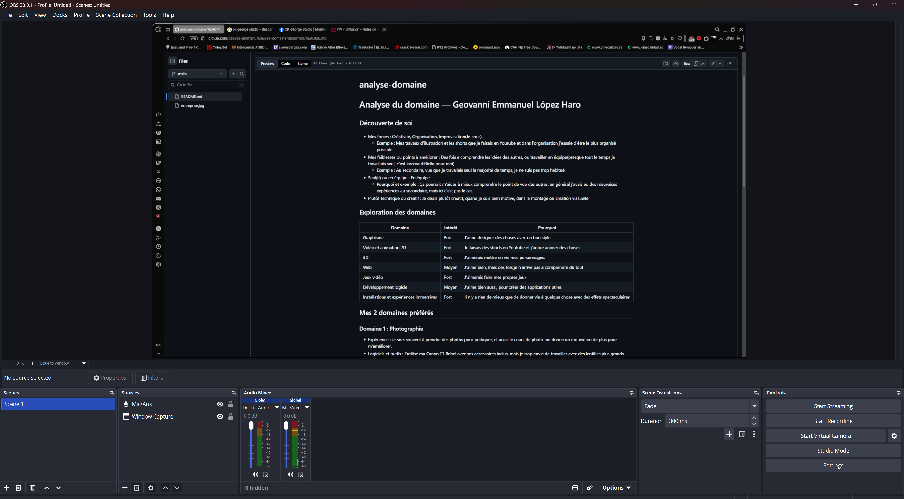

# analyse-domaine
# Analyse du domaine — Geovanni Emmanuel López Haro

## Découverte de soi

- Mes forces : Créativité, Organisation, 
    - Exemple : 
- Mes faiblesses ou points à améliorer : Des fois à comprendre les idées de autres, ou les appliquer 
    - Exemple : 
- Seul(e) ou en équipe : En équipe
    - Pourquoi et exemple : Ça pourrait m'aider à mieux comprendre le point de vue des autres, en général j'avais eu des mauvaises expériences au secondaire, mais ici c'est pas le cas
- Plutôt technique ou créatif :  Je dirais plutôt créatif, quand je suis bien motivé, dans le montage ou creation viasuelle

## Exploration des domaines

| Domaine | Intérêt | Pourquoi |
|---|---|---|
| Graphisme | | Fort | J'aime designer des choses avec un bon style. 
| Vidéo et animation 2D | Fort | Je faisais des shorts en Youtube et j'adore animer des choses. |
| 3D |  | fort | J'aimerais mettre en vie mes personnages.
| Web | Moyen | J'aime bien, mais des fois je n'arrive pas à comprendre du tout. |
| Jeux vidéo | Fort | J'aimerais faire mes propres jeux |
| Développement logiciel | Moyen | J'aime bien aussi  |
| Installations et expériences immersives | Fort | Il n’y a rien de mieux que de donner vie à quelque chose avec des effets spectaculaires |

## Mes 2 domaines préférés

### Domaine 1 : Photographie

- Expérience : Je sors souvent prendre des photos pour pratiquer, et aussi le cours de photo me donne un motivation de plus pour m'améliorer
- Logiciels et outils : J'utilise ma Canon T7 Rebel avec ses accessoires inclus, mais je trop envie de travailler avec des lentilles plus grands.
- Pourquoi il m'intéresse : J'adore prendre des photos avec des styles uniques, et j'aime prendre des mémoires pour le futur.
- Travailler dans ce domaine : J'aimerais travailler en photo, parce que la photographie pourrait m'amener à des endroits que je ne m’attendais pas à visiter et à connaitre des gens. 

### Domaine 2 : Ilustration

- Expérience : 
- Logiciels et outils : ...
- Pourquoi il m'intéresse : ...
- Travailler dans ce domaine : ...

## Les caractéristiques de mon domaine préféré

- Types d'entreprises : ...
- Exemple d'entreprise : ...

(source de l'image : ...)

- Types de produits et de services : ...
- Étapes de production : ...
- Type d'emploi visé : ...
- Étapes pour obtenir cet emploi : ...

## Conclusion

- Mon profil en une phrase : ...
- Ce qui m'a surpris : ...
- Ma force principale et la faiblesse à travailler : ...
- Mon action d'ici la fin de la session : ...

## Ma capsule

